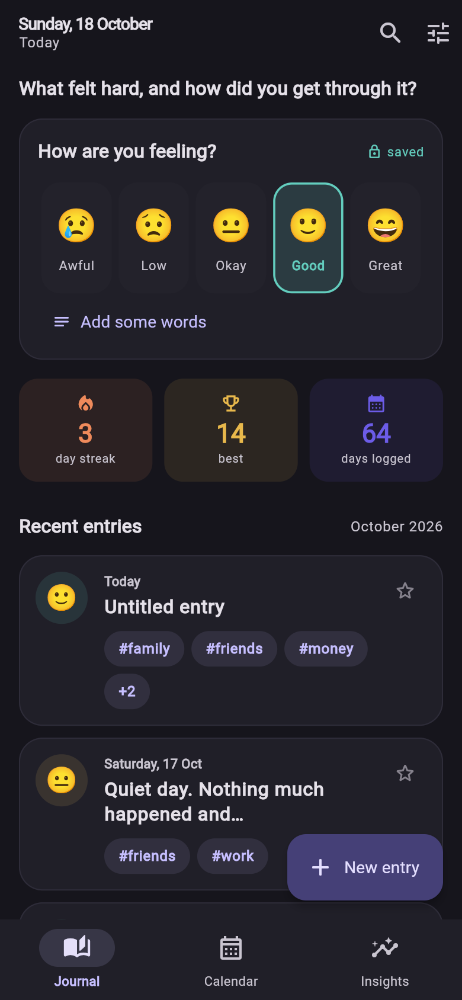
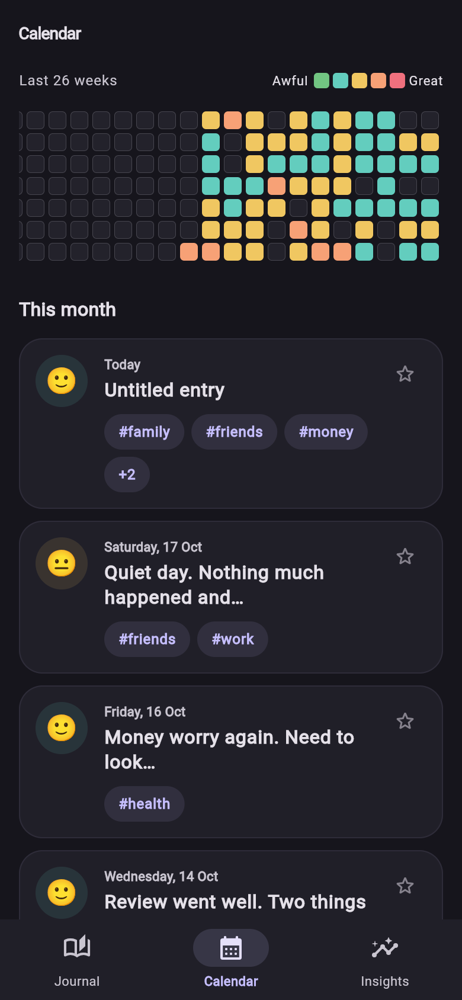
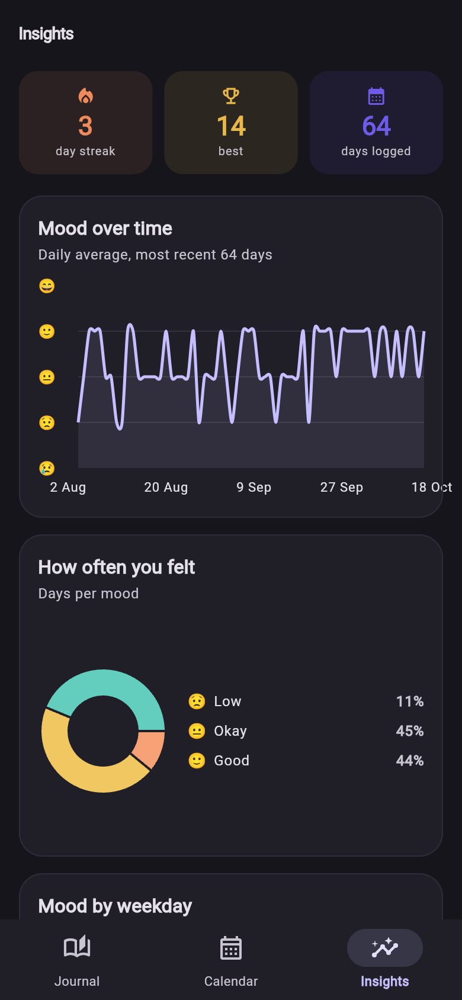
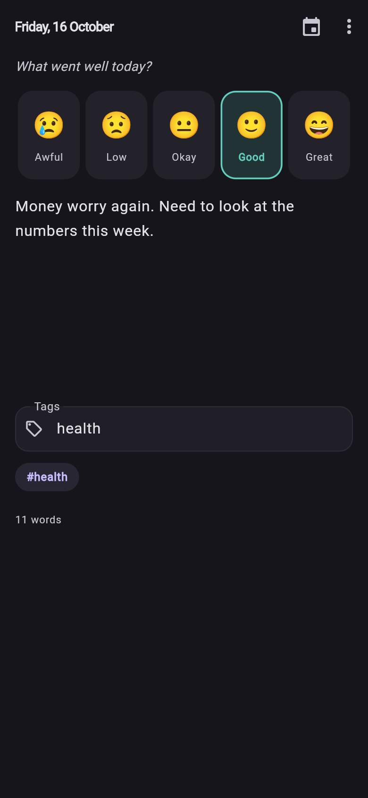
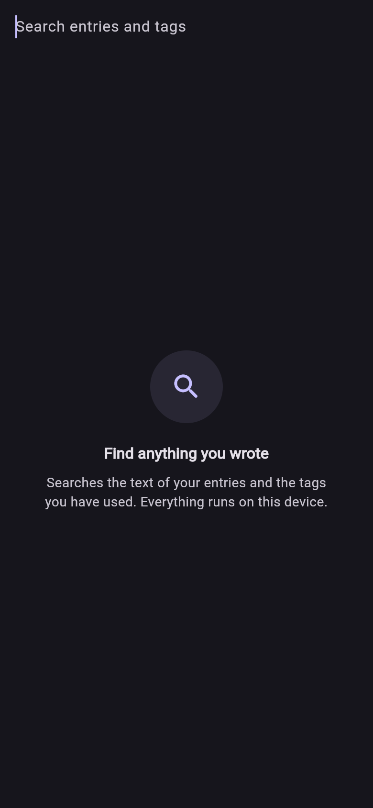
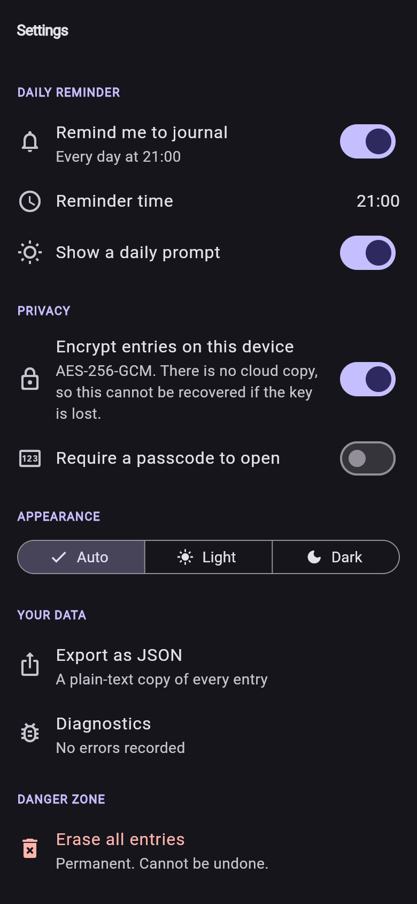
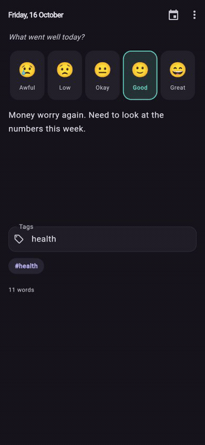

# Mood Journal

> A private, offline-first journal built around a single tap. Log how you feel in
> five seconds; the app turns a year of that into streaks, trends and writing stats.

[](https://docs.flutter.dev)
[](https://dart.dev)
[](LICENSE)

A journal app with **no account, no backend, and no network calls**. Every entry
lives in a local SQLite database; entry text is encrypted at rest with AES-256-GCM
and the key is held in the platform keystore.

---

## The problem this solves

Most journaling apps fail for the same reason: they demand too much. You open one
to jot down a thought and you get a blank page, a title field, a date picker and
a save button.

So the core interaction here is **one tap on an emoji that saves immediately**.
No save button, no keyboard, no friction. Everything else in the app — the
calendar, the charts, the streaks — is just history derived from those taps.

## Screens

Captured from the real app running in a browser — `flutter build web`, then
headless Chrome over the DevTools Protocol. See [`tool/`](tool) for the
scripting.

| Journal | Calendar | Insights |
|---|---|---|
|  |  |  |

| Editor | Search | Settings |
|---|---|---|
|  |  |  |

<details>
<summary>▶ Demo video</summary>



</details>


## Features

- **Five moods** stored as integers, so averages and charts are meaningful.
- **Streaks** with the awkward cases handled: multiple entries a day count once, a
  one-day gap is forgiven, two days resets it, today being empty doesn't break a
  streak that ended yesterday, and future-dated entries never extend one.
- **Autosave** in the editor (800 ms debounce) that also flushes on dispose, so
  backing out never loses the last sentence.
- **Debounced search** (150 ms) over entry text and tags.
- **AES-256-GCM encryption** for entry text, with the key in the platform keystore.
- **Runs on the web as well as mobile** — SQLite compiled to WASM, same code
  path, no second implementation to keep in sync.
- **Export to JSON** via the clipboard.
- **Accessible by construction** — see [Accessibility](#accessibility) below.

## Architecture

```
presentation  ──▶  application  ──▶  domain  ◀──  data
   (widgets)        (providers)     (models)     (db, crypto, repo)
```

Dependencies point one way only. `lib/domain` imports nothing Flutter-specific
and nothing from the outer layers, which is what makes it testable without a
widget tree.

| Concern | Choice | Why |
|---|---|---|
| State | `flutter_riverpod` | Compile-safe providers; `AsyncNotifier` makes loading/error impossible to forget |
| Routing | `go_router` | Declarative routes with a `ShellRoute` that keeps tab state |
| Database | `drift` | Typed SQL, migrations as code, real aggregates instead of loading rows into Dart |
| Crypto | `cryptography` + `flutter_secure_storage` | AES-GCM with a non-extractable platform key |
| Charts | `fl_chart` | Small, no web-canvas dependency |
| Ids | `uuid`, generated client-side | Autosave has a target from the first keystroke |

### One database, two platforms

`lib/data/local/connection/` picks an implementation at compile time via a
conditional export, so there is exactly one set of queries and models:

| Target | Implementation |
|---|---|
| Android, iOS, Windows, macOS, Linux | `NativeDatabase` on a background isolate |
| Web | `WasmDatabase` — SQLite compiled to WASM, in a worker |

Anything else fails loudly at startup rather than silently losing entries.

On the web, drift uses OPFS when the page is cross-origin isolated (COOP/COEP
headers) and falls back to IndexedDB when it isn't, so a plain static deploy
still works — just slower on large databases. `tool/serve.js` sets those headers.

### Project structure

```
lib/
├── core/
│   ├── errors/app_exception.dart
│   ├── theme/{app_theme.dart, mood_palette.dart}
│   └── utils/{day_utils.dart, result.dart}
├── domain/                      ← pure Dart, no Flutter imports
│   ├── models/{mood, journal_entry, stats, insights_bundle, app_settings}.dart
│   └── repositories/journal_repository.dart
├── data/
│   ├── local/
│   │   ├── app_database.dart
│   │   ├── tables.dart
│   │   ├── crypto_service.dart
│   │   └── connection/            ← native / web / stub, picked at compile time
│   └── repositories/drift_journal_repository.dart
└── presentation/
    ├── providers.dart           ← every provider in one place
    ├── router.dart
    ├── app.dart
    ├── error_log.dart           ← last 100 unhandled errors
    ├── demo_seed.dart           ← sample data, opt-in via --dart-define
    ├── screens/                 ← home, editor, calendar, insights, search, settings
    └── widgets/                 ← mood_picker, entry_card, streak_banner, empty_state

tool/                            ← how the screenshots were made
├── serve.js                     ← static server, correct WASM MIME + COOP/COEP
├── capture_web.js               ← headless Chrome over the DevTools Protocol
├── encode_video.js              ← frames → mp4 + gif, via ffmpeg
├── debug_web.js                 ← console/error dump for a blank build
└── notify.ps1                   ← Windows toast when a long job finishes
```
## Getting started

```bash
flutter pub get
dart run build_runner build      # generates app_database.g.dart from the drift tables
flutter run
```

Requires Flutter 3.41+ / Dart 3.11+.

### Running it in a browser

```bash
flutter run -d chrome
```

Or serve a release build:

```bash
flutter build web --release
node tool/serve.js 8099 build/web
```

The web build needs two files that are committed here: `web/sqlite3.wasm`, and
`web/drift_worker.dart.js`. Recompile the worker after editing its source:

```bash
dart compile js -O4 web/drift_worker.dart -o web/drift_worker.dart.js
```

### Regenerating the screenshots

```bash
flutter build web --release --dart-define=DEMO_DATA=true
node tool/serve.js 8099 build/web          # leave running in another terminal
node tool/capture_web.js --out docs/screens --video
node tool/encode_video.js
```

`--dart-define=DEMO_DATA=true` seeds ~11 weeks of sample entries so the captures
show a used app rather than an empty one. It is a compile-time flag, so the
seeder is tree-shaken out of ordinary builds entirely.

## Tests

```bash
flutter test
```

64 tests, all passing.

| Suite | Tests | Covers |
|---|---|---|
| `test/streak_test.dart` | 21 | Streak edge cases, DST-aware day bucketing, word counting, mood mapping |
| `test/journal_repository_test.dart` | 30 | Every query against an in-memory database, the encryption round-trip, tag handling |
| `test/mood_picker_test.dart` | 7 | Rendering, tap targets, and screen-reader labels |
| `test/journal_entry_test.dart` | 6 | Title derivation and list-row preview behaviour |

The repository tests use an in-memory `NativeDatabase` and a fake `SecretStore`, so
the envelope format is exercised for real without needing platform channels.

## Design decisions worth knowing

These are the choices that aren't obvious from reading the code.

**Moods are integers, not strings.** Storing `"good"` / `"great"` would force a
lookup table into every chart and make "worst mood this month" ambiguous. Integers
average.

**A day with no entries is `null`, never `0`.** A zero would pull every average
down and paint every blank day red on the heatmap.

**The line chart pins the y-axis to 1–5.** An auto-scaled axis turns a 3.4 → 4.1
improvement into a dramatic mountain range. The scale should be honest.

**Search decrypts instead of using SQL.** Encrypted text cannot be matched by
`LIKE`, and a plaintext search index would undo the encryption entirely. So search
decrypts the 2 000 most recent rows in memory and filters them. A journal is
thousands of rows, not millions.

**Only the text is encrypted.** Dates and moods stay plaintext so the heatmap,
streaks and charts can be computed with SQL aggregates rather than decrypting
every row on every frame.

**There is no cloud sync in v1.** The value of this app is that it is private and
it works on a plane. Sync can be added later without touching the domain layer,
because nothing above `JournalRepository` knows where the data came from.

## Accessibility

Not an afterthought — these are the requirements the code was written against:

- Every mood control has a semantic label (`"Mood: Good"`) on a single merged
  node that also carries the tap action and the selected state. A screen reader
  focuses a labelled button, not an unlabelled one.
- Mood is never conveyed by colour alone; the emoji and the text label carry the
  meaning. This is a WCAG 1.4.1 requirement.
- Touch targets are at least 48×48.
- `MoodPalette` falls back to a static palette by brightness rather than
  force-unwrapping, so a missing theme degrades instead of crashing.

There is a regression test for the last one, because it was once a crash.

## Roadmap

Not built yet, and tracked honestly:

- [ ] **Local notifications** — the reminder setting persists, but scheduling
      needs real-device testing
- [ ] **Passcode lock screen** — setting persists; the gate itself is not built
- [ ] **JSON import** — needs a conflict-merge policy before it is safe
- [ ] **Secondary moods** — the schema already supports "great but anxious"
- [x] ~~Web~~ — done, via a compile-time conditional database opener

The 2 000-entry 60 fps target in `SPEC.md` §7 is still unmeasured; it needs a
physical device.

## Contributing

Issues and pull requests are welcome. Please read [CONTRIBUTING.md](CONTRIBUTING.md)
first — it covers the setup, the conventions this codebase follows, and the few
places where a "clean" change would quietly break the app.

## License

[MIT](LICENSE)
